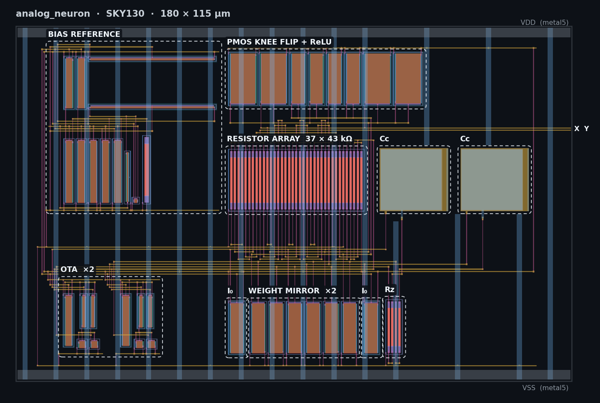
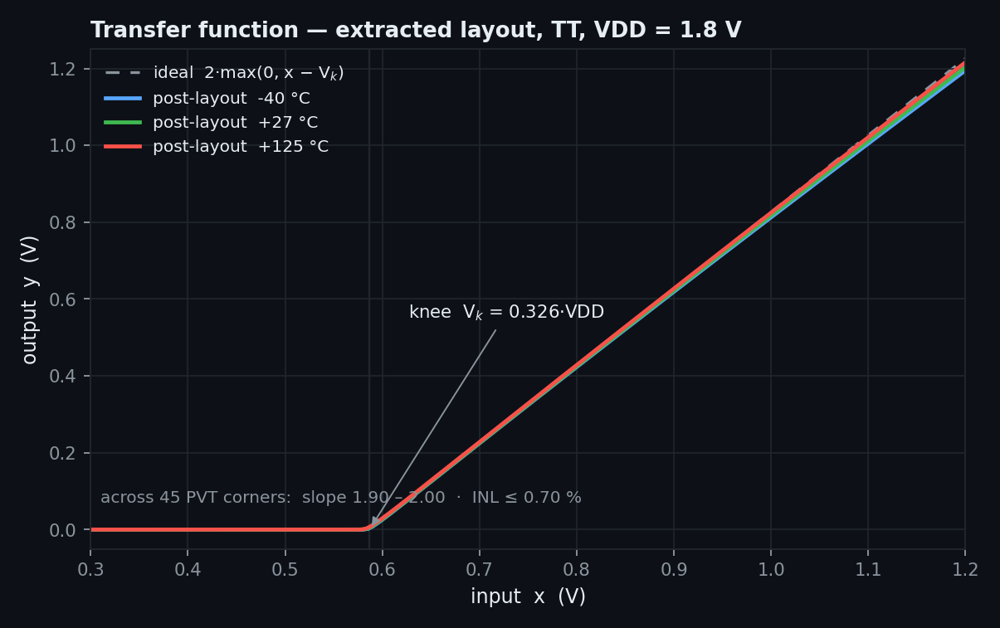
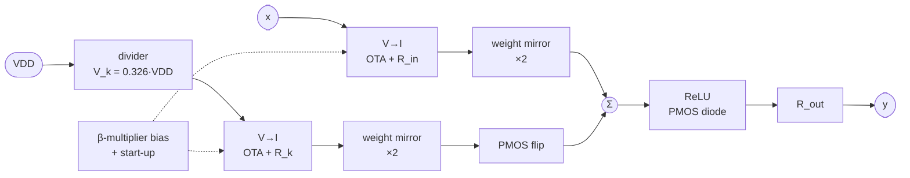

<div align="center">

# analog_neuron

**A single-input analog ReLU neuron in SkyWater SKY130: schematic to GDS with a fully open-source flow.**




</div>

## What it computes

<div align="center">

**y = 2 · max(0, x − V<sub>k</sub>)**  with the knee **V<sub>k</sub> = 0.326 · VDD** (0.586 V at 1.8 V)



</div>

## How it works



- **Ratiometric gain.** The weight is 2 · R<sub>out</sub>/R<sub>in</sub>: one matched resistor ratio and one
  mirror ratio, so it barely moves with process, temperature or supply.
- **Knee replica.** A second, identical V→I converter turns the knee voltage into a current that is
  subtracted at Σ. The shared internal reference cancels, leaving a knee set purely by a VDD ratio.
- **ReLU for free.** The PMOS diode at Σ can only source current, so the output is exactly zero
  until the signal current exceeds the knee current.

## Results

Post-layout (extracted devices and parasitic capacitance), 5 process corners × −40 / 27 / 125 °C × 1.62 / 1.8 / 1.98 V.

| | Result | Spec |
|---|---|---|
| MAC linearity (INL) | **≤ 0.70 %** | ≤ 5 % ✅ |
| Weight accuracy σ (200-run Monte Carlo) | **1.47 %** | < 2–3 % ✅ |
| Weight (slope) | 1.90 – 2.00 | 2 |
| Total power | **38 – 78 µW** | < 100 µW ✅ |
| Loop phase margin | **≥ 62.5°** | ≥ 60° ✅ |
| Bias current (incl. ±20 % resistor spread) | 1.13 – 3.89 µA | 1 – 5 µA ✅ |
| Area | 180 × 115 µm | 180 × 115 µm ✅ |

## Pins

| Pin | Layer | Location (µm) | Notes |
|---|---|---|---|
| `X` | metal3 | right edge, y = 81.27 | input, 0.3 – 1.2 V, ≈ 300 kΩ |
| `Y` | metal3 | right edge, y = 82.07 | output, unbuffered ≈ 300 kΩ: measure with ≥ 10 MΩ |
| `VDD` | metal5 | top rail | 1.8 V |
| `VSS` | metal5 | bottom rail | ground |

## Repository

```
spice/      netlists and testbenches   (bias/ · neuron/ · lvs/ · smoke/ · char/)
scripts/    sim.py (PVT / Monte Carlo runner) · layout/ (layout generator) · DRC / LVS / PEX / GDS
mag/        Magic layout, generated by scripts/layout/
gds/        analog_neuron.gds
verif/      DRC and LVS logs, simulation evidence
docs/       design notes, sign-offs, images
submit/     submission package: GDS, LVS netlist, README
```

## Reproduce

Requires Magic, netgen, ngspice and the SKY130A PDK (`PDK_ROOT=$HOME/.ciel`, `PDK=sky130A`).

```bash
# simulate: 45 PVT corners, then 200-run mismatch Monte Carlo
python3 scripts/sim.py spice/neuron/neuron_tb.cir --pvt --jobs 12
python3 scripts/sim.py spice/neuron/neuron_tb.cir --mc 200 --corner tt_mm --jobs 12

# generate the layout
for b in ota5p bias_ref neuron_core top; do python3 scripts/layout/$b.py; done

# verify
CELL=analog_neuron scripts/magic_batch.sh scripts/drc.tcl mag/neuron
scripts/lvs.sh analog_neuron mag/neuron spice/lvs/analog_neuron_ref.spice analog_neuron
```

<sub>Tools: Magic 8.3.683 · netgen 1.5.324 · ngspice 47 · KLayout 0.30 · SKY130A via ciel.
Details: <a href="docs/ADR-001-neuron-architecture.md">architecture</a> ·
<a href="docs/neuron-core.md">design notes</a> · <a href="docs/layout.md">layout</a> ·
<a href="docs/gate-A.md">schematic sign-off</a> · <a href="docs/gate-B.md">layout sign-off</a></sub>
