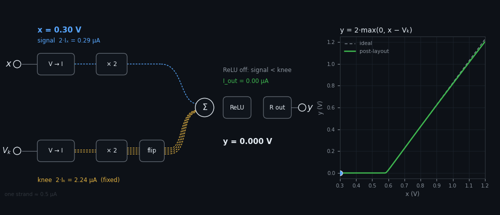
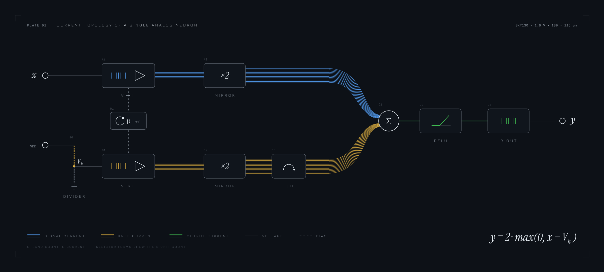
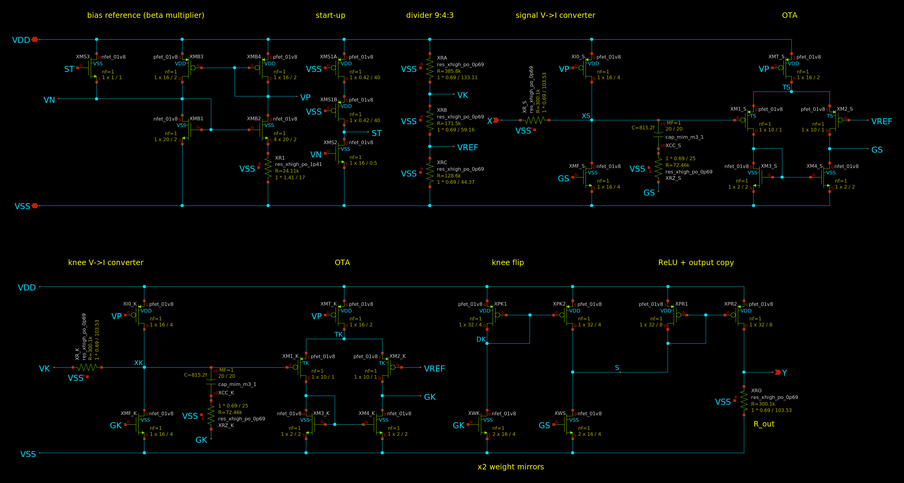

<div align="center">

# analog_neuron

**An analog ReLU neuron in SkyWater SKY130, taken from schematic to GDS with an open-source flow.**




<sub>Each strand carries ≈ 0.5 µA. The signal current grows with x, the knee current stays fixed, and the output
carries only the excess. That excess is the ReLU. The plot on the right is the post-layout transfer curve.</sub>

<table>
<tr>
<td align="center" width="25%"><h3>≤ 0.71 %</h3>MAC linearity<br><sub>INL · spec ≤ 5 %</sub></td>
<td align="center" width="25%"><h3>1.47 %</h3>weight mismatch σ<br><sub>200-run Monte Carlo · spec &lt; 2–3 %</sub></td>
<td align="center" width="25%"><h3>≥ 62.5°</h3>phase margin<br><sub>every loop · spec ≥ 60°</sub></td>
<td align="center" width="25%"><h3>≤ 78 µW</h3>total power<br><sub>98 µW with resistors −20 %</sub></td>
</tr>
</table>

<sub>Post-layout results over 45 PVT points: tt/ff/ss/sf/fs × −40/27/125 °C × 1.62/1.8/1.98 V.</sub>

</div>

## How it works



The circuit is one artificial neuron, $y = f(w\,x + b)$. The activation is a ReLU, the weight is fixed at
$w = 2$, and the bias comes from a knee voltage $V_k$:

```math
y \;=\; 2\cdot\max\!\left(0,\; x - V_k\right) \qquad\Longleftrightarrow\qquad w = 2,\quad b = -2V_k
```

All of the arithmetic happens in the current domain. Each voltage becomes a current. Mirrors scale the currents,
Kirchhoff's current law adds and subtracts them at one node, a diode rectifies the result, and a resistor turns
it back into a voltage.

**① Ratiometric references.** A divider from VDD built from xhigh_po unit resistors
($R_a : R_b : R_c = 9:4:3$) sets two references. Including the load of the knee converter's input resistor gives

```math
V_{REF} = \tfrac{21}{148}\,V_{DD} \approx 0.142\,V_{DD}, \qquad V_k = \tfrac{49}{148}\,V_{DD} \approx 0.331\,V_{DD}
```

These are pure resistor ratios, so they track the supply but not temperature or process.

**② Voltage to current.** An OTA holds one end of a resistor at $V_{REF}$ by driving an NMOS $M_F$ that sinks the
resistor's current:

```math
I_x = \frac{x - V_{REF}}{R_{in}}, \qquad I_k = \frac{V_k - V_{REF}}{R_{in}} \qquad (R_k = R_{in} \approx 304\ \text{k}\Omega)
```

The OTA has a PMOS input pair because its inputs sit at about 0.26 V. A small current $I_0 \approx I_{ref}/2$
keeps $M_F$ out of deep subthreshold when $I_x \to 0$.

**③ Weight and sum.** Mirrors with a ratio of 2 copy each $M_F$. A PMOS mirror turns the knee copy around, so the
knee current is sourced into node S while the signal current is sunk from it:

```math
I_S = 2\,(I_x + I_0) - 2\,(I_k + I_0) = \frac{2\,(x - V_k)}{R_{in}}
```

$V_{REF}$ and $I_0$ appear in both paths, so they cancel exactly.

**④ ReLU.** A diode-connected PMOS supplies $I_S$. A diode can only source current, so it turns off whenever the
signal current is smaller than the knee current, which gives $I_{out} = \max(0, I_S)$. The activation function
comes from the physics of a single transistor, with no comparator.

**⑤ Back to voltage.** A second PMOS copies $I_{out}$ into $R_{out}$, which uses the same 7 resistor units as
$R_{in}$:

```math
y = R_{out}\,I_{out} = 2\,\frac{R_{out}}{R_{in}}\,\max(0,\; x - V_k) = 2\cdot\max(0,\; x - V_k)
```

### Design margins

<details>
<summary><b>Why it holds across process, temperature and supply</b></summary>

| Quantity | Set by | Cancels |
|---|---|---|
| Weight $w$ | $2 \cdot R_{out}/R_{in}$ | sheet resistance and its temperature coefficient, transistor threshold |
| Knee $V_k$ | $\tfrac{49}{148}V_{DD}$ | sheet resistance, temperature, process |
| $V_{REF}$, $I_0$, bias | divider, bias reference | appear in both paths and subtract at S |

The absolute currents change by about 2× between −40 °C and 125 °C, but they never set the transfer function.
Across all 45 PVT points the slope stays between 1.90 and 2.00 and the knee stays at $0.326\,V_{DD}$.

</details>

<details>
<summary><b>Bias reference</b>: β-multiplier with start-up</summary>

$M_2$ is $K = 4$ times wider than $M_1$ and has a source resistor $R_1$. A PMOS mirror forces the same current
through both branches, so $V_{GS1} = V_{GS2} + I R_1$ and

```math
I_{ref} \approx \frac{n\,U_T \ln K}{R_1}, \qquad U_T = \frac{kT}{q}
```

This gives about 2 µA at 27 °C ($n \approx 1.3$, $R_1 \approx 24$ kΩ). The circuit can also rest in a stable
zero-current state, so a start-up branch injects current until the loop runs and then turns itself off.
Measured start-up time is 3 µs or less.

</details>

<details>
<summary><b>Accuracy</b>: mismatch, linearity, systematic slope</summary>

- **Mismatch.** Mirror error follows Pelgrom's law, $\sigma(\Delta I/I) \approx (g_m/I_D)\cdot A_{VT}/\sqrt{W L}$.
  Making the mirror gates 4× larger (16/4 µm) cut the weight σ from 2.81 % to 1.47 %. The resistors are
  interdigitated unit segments, so $R_{out}/R_{in}$ matches to well under 1 %.
- **Linearity.** INL is the worst deviation from the line through $(V_k + 0.1\ \text{V})$ and 1.2 V, given as a
  percentage of full scale.
- **Systematic slope.** When $y$ is high, the output PMOS has less drain voltage than the diode. This holds the
  slope 1–5 % below 2.

</details>

<details>
<summary><b>Stability</b>: Miller compensation with a nulling resistor</summary>

Each converter is a two-stage loop compensated by $C_c = 0.8$ pF. Choosing $R_z \approx 72$ kΩ, larger than
$1/g_{m,F}$, moves the Miller zero into the left half-plane, where it adds phase:

```math
f_z = \frac{1}{2\pi\,C_c\,\left(1/g_{m,F} - R_z\right)}
```

The knee loop has a second feedback path through the divider. For that reason it is measured with Middlebrook
double injection at the OTA output. The signal loop has at least 62.5° of phase margin and the knee loop has at
least 85.7°.

</details>

## Schematic

<a href="docs/img/xschem_analog_neuron.png"></a>

<sub>The whole neuron on one xschem sheet, [`xschem/analog_neuron.sch`](xschem/analog_neuron.sch). It shows all 39 devices
with their SKY130 sizes. The top row holds the bias reference, divider and signal converter; the bottom row holds the
knee converter, weight mirrors, knee flip, ReLU and output. Labels such as GS, GK, VP and VREF join the two rows.
netgen matches the sheet with the full SPICE design, 39 devices and 23 nets, with no property errors
([log](verif/lvs/schematic/analog_neuron_comp.out)). Click the image to zoom.</sub>

## Silicon


| Pin | Layer · location (µm) | Signal |
|---|---|---|
| `X` | metal3 · right edge, y = 81.27 | input, 0.3 – 1.2 V |
| `Y` | metal3 · right edge, y = 82.07 | output, 0 – 1.2 V |
| `VDD` | metal5 · top rail | 1.8 V |
| `VSS` | metal5 · bottom rail | ground |

The cell is 180 × 115 µm, with metal4 straps running vertically and metal5 rails running horizontally. The
interface is defined in [`analog_neuron.v`](submit/analog_neuron.v).

> [!IMPORTANT]
> `Y` is unbuffered, a ≈ 300 kΩ source, so read it with a high-impedance input. A 10 MΩ load lowers the gain
> by 2.8 % and a 1 MΩ load lowers it by 22 %. Linearity is unaffected.

## Sign-off

| Check | Tool | Result |
|---|---|---|
| DRC, every cell and the GDS read back | Magic `drc(full)` | ✅ 0 |
| DRC, manufacturing rules (FEOL, BEOL, off-grid) | KLayout `sky130A_mr.drc` | ✅ 0 |
| LVS, every cell and the GDS | netgen `sky130A_setup.tcl` | ✅ unique match, 0 property errors |
| Schematic ↔ SPICE netlist, full sheet and every cell | xschem netlist + netgen | ✅ unique match, 0 property errors |
| Antenna | Magic `antennacheck` | ✅ 0 |
| Pin labels, zero-area shapes | KLayout PDK decks | ✅ 0 · 0 |
| GDS ↔ .mag | layer-by-layer XOR | ✅ identical |

Evidence is in [`verif/`](verif), summarised in [`SUMMARY.md`](verif/crossverify/SUMMARY.md) and the
[validation report](submit/analog_neuron_validation.pdf). `python3 scripts/make_submission.py` builds the
Silicluster v3 package containing every item §10 of the call asks for ([contents](submit/README.md)).

<details>
<summary><b>Reproduce everything</b></summary>

Requires Magic, netgen, ngspice, KLayout and the SKY130A PDK (`PDK_ROOT=$HOME/.ciel`, `PDK=sky130A`).

```bash
# simulate: schematic over 45 PVT corners, 200-run Monte Carlo, then the extracted layout
python3 scripts/sim.py spice/neuron/neuron_tb.cir --pvt --jobs 12
python3 scripts/sim.py spice/neuron/neuron_tb.cir --mc 200 --corner tt_mm --jobs 12
python3 scripts/sim.py spice/neuron/neuron_pex_tb.cir --pvt --jobs 12
python3 scripts/sim.py spice/neuron/neuron_pex_mb_tb.cir --pvt --jobs 12

# schematics: write xschem/*.sch, LVS them against the netlists, screenshot the full sheet
python3 scripts/schematics.py --check --export

# generate the layout and the GDS
for b in ota5p bias_ref neuron_core top; do python3 scripts/layout/$b.py; done
CELL=analog_neuron OUT=$PWD/gds/analog_neuron.gds scripts/magic_batch.sh scripts/gds.tcl mag/neuron

# verify
CELL=analog_neuron scripts/magic_batch.sh scripts/drc.tcl mag/neuron
scripts/lvs.sh analog_neuron mag/neuron spice/lvs/analog_neuron_ref.spice analog_neuron
klayout -b -rd input=gds/analog_neuron.gds -rd top_cell=analog_neuron -rd report=build/drc.lyrdb \
        -rd feol=true -rd beol=true -rd offgrid=true -r $PDK_ROOT/sky130A/libs.tech/klayout/drc/sky130A_mr.drc

# report and submission package
python3 scripts/validation_report.py
python3 scripts/make_submission.py
```

</details>

---

<div align="center"><sub>
<a href="docs/ADR-001-neuron-architecture.md">architecture</a> ·
<a href="docs/neuron-core.md">neuron core</a> ·
<a href="docs/bias-reference.md">bias reference</a> ·
<a href="docs/layout.md">layout</a> ·
<a href="docs/gate-A.md">schematic sign-off</a> ·
<a href="docs/gate-B.md">layout sign-off</a>
<br>Magic 8.3.683 · netgen 1.5.324 · ngspice 47 · KLayout 0.30 · SKY130A via ciel
</sub></div>
